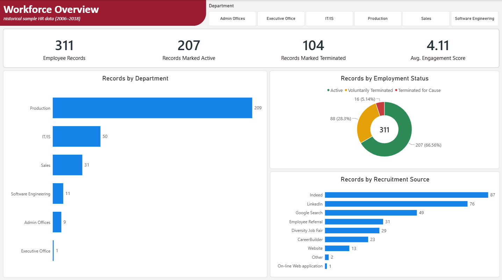
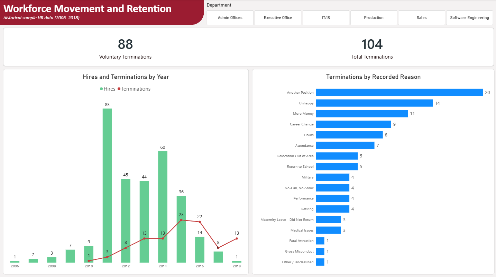
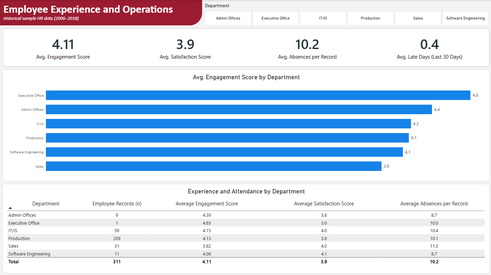
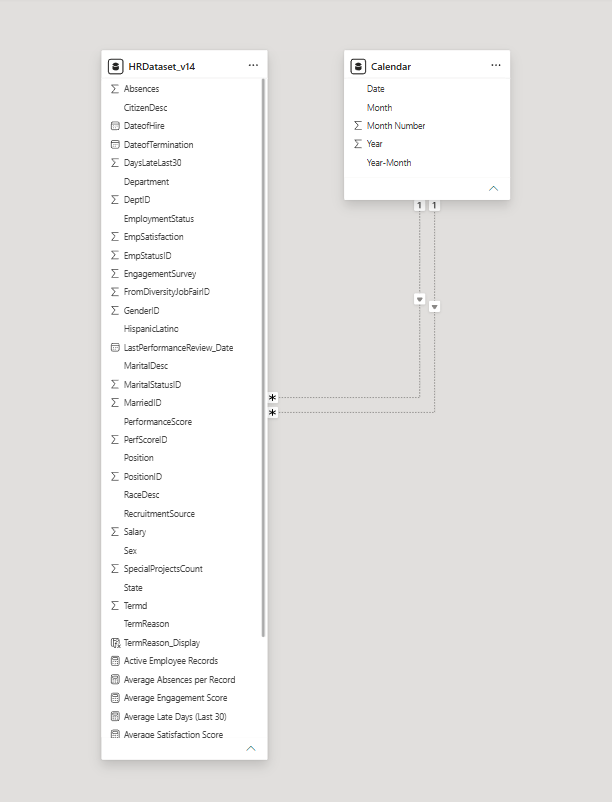
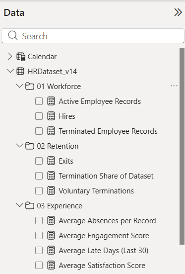

# People Analytics Workforce Insights

**A Power BI portfolio project exploring workforce composition, employee movement, recruitment, and employee experience in a historical HR sample.**

The report turns 311 employee records from 2006–2018 into a three-page set of descriptive dashboards. It combines a date-aware data model, reusable DAX measures, and portfolio-ready aggregate exports. The figures describe this historical sample; they are not current workforce statistics or evidence of business impact.

## Project at a glance

| | |
|---|---|
| Project type | Workforce analytics and Power BI reporting |
| Reporting tool | Microsoft Power BI Desktop |
| Data preparation and calculations | Power Query and DAX |
| Source | Historical sample HR dataset from [sum1tk/hr-analytics](https://github.com/sum1tk/hr-analytics) |
| Coverage | 311 employee records; hire years shown in the report span 2006–2018 |
| Report pages | Workforce Overview; Workforce Movement and Retention; Employee Experience and Operations |
| Published outputs | Five aggregate CSV summaries, DAX reference, data-model and measure screenshots, privacy-safe dashboard screenshots |

## Executive summary

| Measure | Result | Interpretation |
|---|---:|---|
| Employee records | 311 | Historical sample size |
| Records marked active | 207 (66.6%) | Share of sample records marked active |
| Records marked terminated | 104 (33.4%) | Share of sample records marked terminated; **not** an annual turnover rate |
| Voluntary terminations | 88 (84.6% of terminated records) | Voluntary records divided by all 104 terminated records |
| Average engagement score | 4.11 | Overall sample average |
| Average satisfaction score | 3.9 | Overall sample average |
| Average absences per record | 10.2 | Average count per record; the source does not define a measurement window |
| Average late days in the last 30 days | 0.4 | Average recorded days late |

### Selected findings from the published aggregates

- The three most common recorded recruitment sources are Indeed (87), LinkedIn (76), and Google Search (49), together representing 68.2% of the 311 records.
- Of 104 termination records, 20 list “Another Position,” 14 “Unhappy,” and 11 “More Money” as the recorded reason. These are descriptive categories, not evidence of why employees left.
- The published movement summary groups events into two broad periods. It records 150 hires and 12 terminations in 2006–2012, and 161 hires and 92 terminations in 2013–2018. The latter period contains 88.5% of the sample's recorded terminations; this is a count comparison, not a period-specific attrition rate.
- Among department groups included in the experience summary, average engagement ranges from 3.82 to 4.39. Small-group suppression and differences in group size mean these averages should not be treated as directly comparable performance rankings.

**Impact boundary:** This project delivers a structured, filterable analytical view and documented measures. It does not measure interventions, cost savings, retention improvements, or other realized organizational outcomes.

## Dashboard

The dashboard is organized to move from workforce composition to movement and then employee experience. These screenshots show the original report visuals, including year-level counts and categories with fewer than five records. They are included to present the dashboard as built; use the aggregate CSV summaries for outputs that apply small-cell suppression.

### 1. Workforce Overview

Shows total records, employment status, department distribution, and recruitment sources.

### 2. Workforce Movement and Retention

Shows annual hires and terminations and the report's recorded termination-reason categories, including low-frequency counts.

### 3. Employee Experience and Operations

Compares engagement, satisfaction, absences, and recent lateness across departments. The screenshot preserves the original department breakdowns.

## What I built

| Workstream | Implementation |
|---|---|
| Data preparation | Used Power Query to trim text, assign date and numeric types, and remove direct identifiers from the local model. |
| Data model | Connected the employee table to a calendar table using hire-date and termination-date relationships. Date-specific measures use `USERELATIONSHIP` to select the appropriate date role. |
| DAX layer | Created 11 measures for workforce counts, hires and exits, termination share, engagement, satisfaction, absences, and lateness. Added a calculated display-label column for termination reasons. |
| Report design | Built three pages with department filtering, headline indicators, trend and category charts, and a department comparison table. |
| Portfolio exports | Prepared five aggregate CSVs, suppressing small department and recruitment-source groups, grouping low-frequency termination reasons, and rolling movement into broad periods. |
| Documentation | Published the measure reference and sanitized screenshots while excluding employee-level records and the local Power BI file. |

The model screenshot illustrates the employee and calendar tables. The measure screenshot shows the report's grouped DAX measures.

## Measures and analytical approach

| Measure area | Examples | Purpose |
|---|---|---|
| Workforce | Employee records; active records; terminated records | Describe the sample's recorded employment status |
| Movement and retention | Hires; exits; voluntary terminations; termination share | Count events and distinguish status share from time-based rates |
| Experience and operations | Average engagement; satisfaction; absences; late days | Summarize available experience and attendance fields |

### Modeling and calculation choices

- The calendar table contains date, month, month number, year, and year-month fields for time-based reporting.
- Hire and termination dates are separate analytical roles. The measures activate the relevant date relationship when counting hires or exits.
- Employment status and termination flag fields are used for their distinct purposes in the documented measures; the termination share is explicitly the number marked terminated divided by all records.
- `TermReason_Display` normalizes selected source labels for chart display. The original source field is retained in the local model.
- Public summary files are derived aggregates, not anonymized row-level data and not drop-in replacements for the local employee-level model.

## What I learned

- A terminated-record share is not the same as a turnover rate. Time-based workforce measures need a defined period and an appropriate workforce denominator.
- Hire dates and termination dates are separate analytical roles. Explicitly selecting the relevant calendar relationship makes event counts easier to interpret and validate.
- Suppression rules should be checked across every output. The published aggregate summaries suppress small groups; the original dashboard screenshots intentionally show the report's full category and year-level detail.
- Averages need context. Department-level differences should be considered alongside group sizes, suppressed categories, and the limits of the source fields; they do not demonstrate cause or performance.

## Data products

| Path | Contents |
|---|---|
| `portfolio-data/employment-status-summary.csv` | Record counts by employment status |
| `portfolio-data/workforce-movement-summary.csv` | Hires and terminations in two broad periods |
| `portfolio-data/recruitment-source-summary.csv` | Recruitment-source counts; categories below the publication threshold are omitted |
| `portfolio-data/termination-reason-summary.csv` | Termination-reason counts; low-frequency categories are grouped |
| `portfolio-data/department-experience-summary.csv` | Department-level experience and absence averages; small groups are omitted |
| `hr-analytics-measures.dax` | DAX reference for the local model |
| `img/page-*.png` | Original dashboard screenshots with report-level detail |
| `img/portfolio-safe-data-model.png` | Data-model screenshot |
| `img/portfolio-safe-calculated-measures.png` | DAX measure-group screenshot |

Small-cell suppression means some category totals may not add up to the full sample total. The published CSVs contain aggregate data only.

## Reproducing the published summaries

1. Open the CSVs in `portfolio-data/` in Power BI Desktop or another analysis tool.
2. Build visuals from the available aggregate fields. Respect the privacy threshold when making additional breakdowns.
3. Refer to `hr-analytics-measures.dax` for the local model's calculation logic. Those expressions reference the employee-level `HRDataset_v14` and `Calendar` tables and will need to be redesigned for the aggregate CSVs.

The local PBIX and downloaded employee-level CSV are intentionally excluded from this repository. The published summaries support the high-level portfolio views, but cannot reproduce the full-grain local model or every year-level chart. For dataset provenance and licensing, consult the [source repository](https://github.com/sum1tk/hr-analytics).

## Data handling and interpretation

- The dataset is a historical sample spanning 2006–2018, not a current employee census.
- A termination share across all sample records is not an annualized attrition or turnover rate. A valid rate requires an appropriate time period and workforce denominator.
- The source does not define a time window for absence counts; they are presented as averages per record, not absence rates.
- Recruitment-source counts measure records attributed to a channel, not candidate quality, hiring conversion, or channel effectiveness.
- Department averages are descriptive and can be unstable for small groups. The aggregate CSV summaries suppress groups below five; the original dashboard screenshots retain the report's department breakdowns.
- Termination reasons reflect source-recorded categories and do not establish causation.
- The source does not contain LMC or grievance data; those processes are outside this analysis.
- Employee-level records and the local PBIX are not published. The original dashboard screenshots do show small-group counts, including categories with fewer than five records. The aggregate CSV summaries apply suppression or grouping, but are distinct outputs and do not change what is visible in the screenshots.

## Source and attribution

The sample dataset was obtained from [sum1tk/hr-analytics](https://github.com/sum1tk/hr-analytics). Refer to that repository for dataset provenance and licensing information. This project is an independent portfolio analysis and is not an official report from the dataset publisher.
